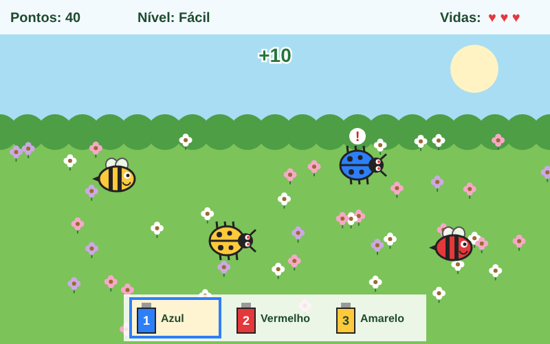

# 🐝 Let It Bee!

> *Um jardim precisa de proteção. Mas cuidado com quem você escolhe atingir!*

Jogo de **ação, atenção e reflexos** feito com HTML, CSS, JavaScript e Canvas. Proteja o jardim eliminando os insetos invasores com o inseticida da cor certa e deixe as abelhas passarem em paz.



---

## 📖 Sobre o jogo

Insetos invasores estão atacando as plantas do jardim. Para protegê-lo, você usa inseticidas de três cores. O desafio é **identificar rápido** cada personagem: distinguir as abelhas dos invasores e escolher o inseticida da mesma cor do invasor.

**A cor escolhe o inseticida. O tipo do personagem decide se você deve atirar.**

### 🎯 Objetivo
Eliminar o maior número possível de insetos invasores, proteger as abelhas e ficar no jogo pelo maior tempo possível.

---

## 🐞 Personagens

| | Personagens | Aparência | O que fazer |
|---|---|---|---|
| 🐝 **Abelhas** | Azul, vermelha e amarela | Corpo listrado, asas brancas e sorriso | **Proteger** (deixar passar) |
| 🪲 **Invasores** | Azul, vermelho e amarelo | Casco com manchas, cabeça preta e patas | **Eliminar** |

---

## 🎮 Como jogar

| Comando | Ação |
|:---:|---|
| `1` | Seleciona o inseticida **azul** 🔵 |
| `2` | Seleciona o inseticida **vermelho** 🔴 |
| `3` | Seleciona o inseticida **amarelo** 🟡 |
| 🖱️ Clique no personagem | Dispara o inseticida selecionado |
| 🖱️ Clique na lata | Escolhe o inseticida pela barra de baixo do jogo |

**Exemplo:** apareceu um inseto azul? Aperte `1` e clique nele. Apareceu uma abelha azul? Deixe-a passar!

💡 **Dicas:**
- A mira muda de cor conforme o inseticida selecionado.
- Quando aparece um **!** em cima de um inseto, ele está prestes a fugir.

---

## 🏆 Pontuação e vidas

Você começa com **3 vidas** ❤️❤️❤️

| Ação | Resultado |
|---|---|
| Eliminar inseto com a cor correta | ✅ **+10 pontos** |
| Atingir inseto com a cor errada | ❌ −1 vida |
| Atingir uma abelha | ❌ −1 vida |
| Deixar um inseto escapar | ❌ −1 vida |
| Clicar em um espaço vazio | ➖ Sem penalidade |

## 📈 Dificuldade

A dificuldade aumenta de **dois jeitos**:

**Pelas vidas**

| Vidas | Nível | Como fica |
|:---:|---|---|
| ❤️❤️❤️ | Fácil | Personagens lentos, aparecem menos |
| ❤️❤️ | Médio | Mais rápidos, aparecem mais |
| ❤️ | Difícil | Velocidade máxima, aparições imprevisíveis |
| 💀 | Fim de jogo | Mostra a pontuação final |

**Pelos pontos**

| Pontos | O que muda |
|:---:|---|
| 50 ★ | Tudo fica 25% mais rápido |
| 100 ★★ | Tudo fica 50% mais rápido |

Até **4 personagens** podem estar na tela ao mesmo tempo, e eles aparecem em lugares e momentos imprevisíveis.

---

## 🚀 Como executar

Não precisa instalar nada!

1. Baixe ou clone esta pasta.
2. Abra o arquivo **`index.html`** no navegador (Chrome, Edge ou Firefox).
3. Vá até a página **Jogar** e clique em **Iniciar jogo**.

> Se usar o VS Code, também dá para abrir com a extensão **Live Server**.

---

## 📁 Estrutura do projeto

```
Garden Guardian/
├── index.html          → página principal (apresentação do jogo)
├── jogo.html           → página com o jogo e as instruções
├── dev.html            → página da desenvolvedora e referências
├── README.md           → este arquivo
├── css/
│   └── style.css       → estilo das três páginas
├── img/
│   ├── tela-do-jogo.png
│   └── anacarolina.jpg
└── js/
    └── jogo.js         → todo o código do jogo
```

### Como o `jogo.js` está organizado

| Parte | O que faz |
|:---:|---|
| 1 | Pega os elementos do HTML (canvas e botão) |
| 2 | Variáveis do jogo (pontos, vidas, personagens...) |
| 3 | Nível de dificuldade (pelas vidas e pelos pontos) |
| 4 | Cria os personagens em posições sorteadas |
| 5 | Move os personagens e controla quando eles fogem |
| 6 | Desenha o cenário, personagens, placar, inseticidas e mira |
| 7 | Perda de vidas e fim de jogo |
| 8 | Teclado (1, 2, 3) e mouse (mira e clique) |
| 9 | Loop do jogo (60 quadros por segundo) e botão de iniciar |

---

## 🛠️ Tecnologias

- **HTML5**: estrutura das páginas e o elemento `<canvas>`
- **CSS3**: visual do site
- **JavaScript**: lógica do jogo, eventos de teclado e mouse
- **Canvas API**: todos os personagens e o cenário são desenhados com código

---

## 📚 Referências

- **Imagens e sprites:** nenhum material de terceiros. Personagens e cenário foram desenhados com código.
- **Sons:** o jogo não usa sons.
- **Documentação consultada:**
  - [Tutorial de Canvas (MDN)](https://developer.mozilla.org/pt-BR/docs/Web/API/Canvas_API/Tutorial)
  - [setInterval (MDN)](https://developer.mozilla.org/pt-BR/docs/Web/API/setInterval)
  - [addEventListener (MDN)](https://developer.mozilla.org/pt-BR/docs/Web/API/EventTarget/addEventListener)
  - Arquivos das aulas da matéria de Full Stack

### 🤖 Uso de inteligência artificial
Este projeto contou com o apoio do **Claude** (Anthropic) para montar o código a partir da descrição do jogo, explicar cada parte com comentários e ajudar nas modificações. A ideia, as regras e os personagens são de minha autoria, e todo o código foi lido, testado e estudado por mim.

---

## 👩‍💻 Desenvolvedora

**Ana Carolina G. da Silva**
Ciência de Dados e IA, 1º semestre, Centro Universitário FEI

Mais informações na página [`dev.html`](dev.html).

---

<p align="center">Feito com 💛 e muitas abelhas 🐝</p>
